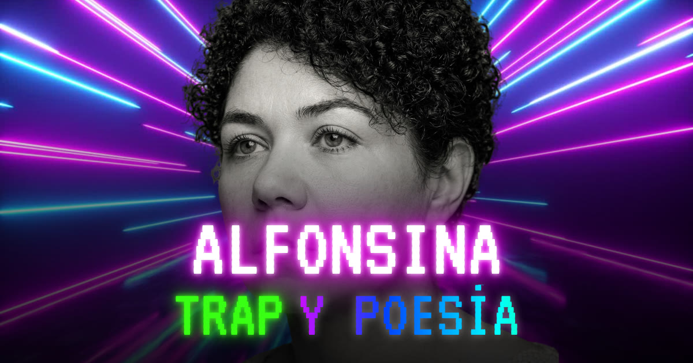

# Alfonsina: Trap y Poesía

Visita el proyecto en el siguiente enlace:

## **[https://alfonsinatrapypoesia.lidyacota.com](https://alfonsinatrapypoesia.lidyacota.com/)**

Homenaje a Alfonsina Storni: ocho poemas de "El dulce daño" (1918) recontextualizados en el trap, el reggaetón y el dembow. Remediación transmedia y obra de literatura digital de Lidya Cota (Ciudad de México, 2026).

## Sobre la obra

"Alfonsina: Trap y Poesía" es un homenaje transmedia a la poeta argentina Alfonsina Storni (1892–1938). Ocho poemas de su libro "El dulce daño" (1918) se recontextualizan en el trap, el reggaetón y el dembow mediante producción musical asistida por inteligencia artificial. Los poemas permanecen intactos, palabra por palabra, en su español original: lo que se desplaza es el medio, el contexto y, por lo tanto, su sentido.

Concebida como un álbum-libro digital, la pieza opera como una traducción intersemiótica que lleva cada poema de la página impresa al sonido, la voz y la imagen. Cada track se despliega como una página que reúne la música, presentada en formato de video; el prompt técnico que dio forma a su sonido; y el poema reactivado como poesía visual animada. Creada en la Ciudad de México en 2026 por Lidya Cota, artista transmedia mexicana, la obra se inscribe en la literatura digital hecha por mujeres en Latinoamérica.

## El manifiesto

El manifiesto "para una Remediación Transmedia" es el texto central de la obra: una declaración de postura sobre la inteligencia artificial en la creación artística y sobre quién la dirige. Sus tesis principales, citadas textualmente:

- **La IA como instrumento dirigido, no como automatismo:** "no como automatismo, sino como instrumento de experimentación sonora dirigido por una sensibilidad curatorial específica".
- **El valor está en la dirección, no en la herramienta:** "El valor de esta obra no reside en el uso de la herramienta, sino en su dirección".
- **La técnica no invalida el arte:** "los medios técnicos no invalidan la creación artística, sino que la obligan a precisarse".
- **El prompt como dirección de arte:** la programación de prompts técnicos "funciona como una dirección de arte deliberada".
- **El sitio es la obra:** "El sitio web no aloja la obra: es la obra misma."
- **Tecnología y género:** "La tecnología, en manos de una mujer creadora, no es un instrumento neutro".
- **Alta poesía y cultura popular:** la frontera entre intelectualidad académica y pulsión popular urbana es "una frontera que, en gran medida, siempre fue una frontera de clase".

[Leer el manifiesto completo](https://alfonsinatrapypoesia.lidyacota.com/#manifiesto)

## Tracks

| # | Poema de Alfonsina Storni | Género | Página |
|---|---|---|---|
| 01 | ["Capricho"](https://alfonsinatrapypoesia.lidyacota.com/inicio/capricho/) | Neoperreo & Industrial Reggaeton [Dark Experimental] | [alfonsinatrapypoesia.lidyacota.com/inicio/capricho](https://alfonsinatrapypoesia.lidyacota.com/inicio/capricho/) |
| 02 | ["Dime"](https://alfonsinatrapypoesia.lidyacota.com/inicio/dime/) | Mexican Reggaeton & Perreo Chilango [Viral Street Style] | [alfonsinatrapypoesia.lidyacota.com/inicio/dime](https://alfonsinatrapypoesia.lidyacota.com/inicio/dime/) |
| 03 | ["Primavera"](https://alfonsinatrapypoesia.lidyacota.com/inicio/primavera/) | Modern Dominican Dembow [Aggressive & High-Energy] | [alfonsinatrapypoesia.lidyacota.com/inicio/primavera](https://alfonsinatrapypoesia.lidyacota.com/inicio/primavera/) |
| 04 | ["Tú y yo"](https://alfonsinatrapypoesia.lidyacota.com/inicio/tu-y-yo/) | Modern Polish Reggaeton [Sweet & Melodic] | [alfonsinatrapypoesia.lidyacota.com/inicio/tu-y-yo](https://alfonsinatrapypoesia.lidyacota.com/inicio/tu-y-yo/) |
| 05 | ["Tu dulzura"](https://alfonsinatrapypoesia.lidyacota.com/inicio/tu-dulzura/) | Latin Urban Reggaeton [Sensual & Mid-tempo] | [alfonsinatrapypoesia.lidyacota.com/inicio/tu-dulzura](https://alfonsinatrapypoesia.lidyacota.com/inicio/tu-dulzura/) |
| 06 | ["¡Oh, tú!"](https://alfonsinatrapypoesia.lidyacota.com/inicio/oh-tu/) | Cartoon Trap & Comedy Hip-Hop [Linguistic Glitch] | [alfonsinatrapypoesia.lidyacota.com/inicio/oh-tu](https://alfonsinatrapypoesia.lidyacota.com/inicio/oh-tu/) |
| 07 | ["Viaje finido"](https://alfonsinatrapypoesia.lidyacota.com/inicio/viaje-finido/) | Puerto Rican Reggaeton & Latin Trap [Melancholic Urbano] | [alfonsinatrapypoesia.lidyacota.com/inicio/viaje-finido](https://alfonsinatrapypoesia.lidyacota.com/inicio/viaje-finido/) |
| 08 | ["Risas"](https://alfonsinatrapypoesia.lidyacota.com/inicio/risas/) | Mexican Reggaeton [Chacalón Flow & Dirty Dembow] | [alfonsinatrapypoesia.lidyacota.com/inicio/risas](https://alfonsinatrapypoesia.lidyacota.com/inicio/risas/) |

## Créditos

**[Lidya Cota](https://www.lidyacota.com/):** concepto y curaduría, selección de poemas, manifiesto, producción musical, ingeniería de prompts, edición de video, poesía visual animada, y diseño, dirección y desarrollo del sitio web.

**Poemas:** Alfonsina Storni, "El dulce daño" (Editorial Cooperativa Buenos Aires, 1918). Dominio público.

**Herramientas y recursos:** Suno (producción musical); Gemini (apoyo en el desarrollo de prompts); Canva y videos de stock gratuitos (videos); ChatGPT y Claude (apoyo en el desarrollo del sitio web); tipografías VT323, Share Tech Mono, Roboto Mono y Audiowide de Google Fonts (SIL Open Font License); YouTube y GitHub Pages (publicación).

## Licencia

"Alfonsina: Trap y Poesía" © 2026 Lidya Cota, bajo licencia [Creative Commons Atribución-NoComercial-CompartirIgual 4.0 Internacional (CC BY-NC-SA 4.0)](https://creativecommons.org/licenses/by-nc-sa/4.0/deed.es). Los poemas de Alfonsina Storni son de dominio público.

## Cómo citar

Cota, Lidya. 2026. "Alfonsina: Trap y Poesía" [obra de literatura digital]. Ciudad de México. https://alfonsinatrapypoesia.lidyacota.com/

## Otras obras de literatura digital de Lidya Cota

- **["Bestiario Marino"](https://bestiariomarino.github.io/bestiariomarino/)** (2021), de Abraham Truxillo y Lidya Cota. Mención honorífica en el primer concurso de Literatura Digital Julio Torri (México, 2021).

## Dedicatoria

A Alfonsina Storni, que desafió su tiempo. A las mujeres que somos creadoras y madres. Y a Abraham Truxillo, mi esposo, por quien entiendo más la poesía: en él pensaba mientras elegía cada poema y cada sonido.

---

## English

Visit the project at the following link:

### **[https://alfonsinatrapypoesia.lidyacota.com/en/](https://alfonsinatrapypoesia.lidyacota.com/en/)**

**"Alfonsina: Trap y Poesía"** (Alfonsina: Trap and Poetry) is a transmedia homage to the Argentine poet Alfonsina Storni (1892–1938). Eight poems from her 1918 collection "El dulce daño" are recontextualized within trap, reggaeton, and dembow through AI-assisted music production. The poems remain intact, word for word, in their original Spanish: what shifts is the medium, the context, and therefore their meaning.

Conceived as a digital album-book, the piece operates as an intersemiotic translation, carrying each poem from the printed page into sound, voice, and image. Every track unfolds as a page that brings together the music, presented in video form; the technical prompt that shaped its sound; and the poem reactivated as animated visual poetry. Created in Mexico City in 2026 by Lidya Cota, a Mexican transmedia artist, the work is situated within the digital literature produced by Latin American women.

### The manifesto

The manifesto "for a Transmedia Remediation" is the central text of the work: a statement of position on artificial intelligence in artistic creation and on who directs it. Its main theses:

- **AI as a directed instrument, not automatism:** "not as automatism, but as an instrument of sonic experimentation directed by a specific curatorial sensibility."
- **Value lies in direction, not in the tool:** "The value of this work lies not in the use of the tool, but in its direction."
- **Technique does not invalidate art:** "technical media do not invalidate artistic creation, but compel it to become more precise."
- **The prompt as art direction:** the programming of technical prompts "functions as deliberate art direction."
- **The website is the work:** "The website does not host the work: it is the work itself."
- **Technology and gender:** "Technology, in the hands of a woman creator, is not a neutral instrument."
- **High poetry and popular culture:** the boundary between academic intellectualism and urban popular drive is "a boundary that, to a great extent, was always a class boundary."

[Read the full manifesto in English](https://alfonsinatrapypoesia.lidyacota.com/en/#manifiesto)

### Credits

**[Lidya Cota](https://www.lidyacota.com/):** concept and curation, poem selection, manifesto, music production, prompt engineering, video editing, animated visual poetry, and website design, direction, and development. **Poems:** Alfonsina Storni, "El dulce daño" (1918), public domain. **Tools:** Suno, Gemini, Canva with free stock footage, ChatGPT, and Claude.

**License:** © 2026 Lidya Cota, [CC BY-NC-SA 4.0](https://creativecommons.org/licenses/by-nc-sa/4.0/deed.en). The poems by Alfonsina Storni are in the public domain.

**How to cite:** Cota, Lidya. 2026. "Alfonsina: Trap y Poesía" [work of electronic literature]. Mexico City. https://alfonsinatrapypoesia.lidyacota.com/

**Other works of electronic literature by Lidya Cota:** ["Bestiario Marino"](https://bestiariomarino.github.io/bestiariomarino/) (2021), by Abraham Truxillo and Lidya Cota. Honorable mention in the first Julio Torri Digital Literature contest (Mexico, 2021).

**Dedication:** To Alfonsina Storni, who defied her time. To us women who are creators and mothers. And to Abraham Truxillo, my husband, through whom I understand poetry more deeply: he was on my mind as I chose each poem and each sound.

---

**Palabras clave / Keywords:** Alfonsina Storni, homenaje a Alfonsina Storni, El dulce daño, literatura digital, literatura digital latinoamericana, literatura digital hecha por mujeres, poesía transmedia, remediación transmedia, recontextualización, traducción intersemiótica, poesía visual, arte e inteligencia artificial, música con IA, trap, reggaetón, dembow, Lidya Cota · tribute to Alfonsina Storni, electronic literature, Latin American electronic literature, women in electronic literature, transmedia poetry, digital poetry, visual poetry, AI in art, AI music.

*Notas técnicas: sitio estático en HTML, CSS y JavaScript, publicado en GitHub Pages. Detalles en [LEEME.md](LEEME.md). / Technical notes: static HTML, CSS, and JavaScript site published on GitHub Pages; details in LEEME.md (Spanish).*
